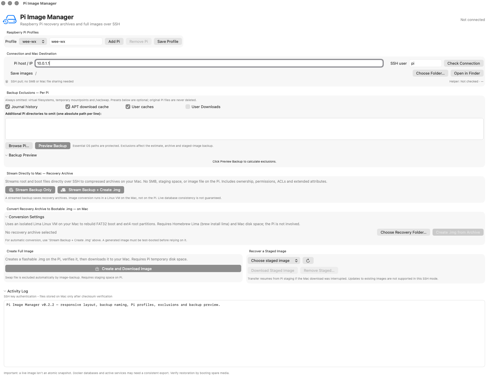

# Pi Image Manager v0.2.2

**Open-source macOS GUI for backing up a running Raspberry Pi over SSH.**

Pi Image Manager has two different backup modes:

- **Stream recovery archive to Mac**: saves Linux root and Pi boot archives directly to a local Mac folder, without staging an `.img` on the Pi. You can optionally convert those archives into a flashable `.img` using Lima on the Mac.
- **Staged full `.img` on Pi**: uses [RonR image-backup](https://github.com/seamusdemora/RonR-RPi-image-utils) on the Pi, checks the resulting filesystems and transfers the image over SSH. This needs substantial Pi-side staging space.

The live backup is **not a point-in-time snapshot**. Databases, constantly changing files and active workloads can produce inconsistent backups. Streaming tar treats changed files as errors rather than silently reporting success.

## v0.2 feature set


- Native macOS SwiftUI app with multiple named Raspberry Pi profiles, a responsive master scroll view and separately scrollable preview/log areas.
- Per-Pi destination, SSH username, host and persistent exclusion settings stored at `~/Library/Application Support/PiImageManager/profiles.json`.
- Generic exclusion presets for journal history, APT package archives, home-directory caches and Downloads.
- Custom exclusions: one exact, absolute directory/file path on the Pi per line (no glob expressions in user paths); SSH-based remote directory browser.
- Preview Backup shows estimated uncompressed source data and each active excluded path/size/status; missing paths are not errors.
- Exactly the same validated exclusion settings drive streaming estimates, streaming archives and staged `.img` backups. `/var/swap` and volatile virtual filesystems are excluded by default.
- Streamed backups include `exclusions.txt` in the SHA-256-verified recovery folder.
- Live byte counters, transfer speed, stage-aware Backup status/ETA and a confirmed Abort Backup button during SSH streaming.
- `.img` reconstruction using an isolated Lima Linux VM on the Mac so no Pi staging necessary for streamed backups.
- Source code, shell scripts, recovery instructions, testing scripts and an open-source license.

### Requirements

- **Mac**: macOS 13+, Swift toolchain/Xcode command-line tools; SSH key authentication; optional [Lima](https://github.com/lima-vm/lima) for `.img` conversion. On Apple Silicon, install Homebrew under `/opt/homebrew` (`/usr/local` may be Intel Homebrew).
- **Pi**: Raspberry Pi OS or compatible Debian Linux, arm64; SSH server; `sudo` to install a root-owned helper; standard FAT boot + ext4 root for `.img` conversion. Some other filesystems/layouts may work for archive-only recovery but **are not supported by the converter**.
- Enough free space on the Mac for streamed archives or reconstructed images. Staged image mode also requires space on the Pi (see connection status).
- The Pi-side installer needs Internet access to install packages and fetch RonR's imaging engine.


## Setting Up SSH on Your Raspberry Pi

Pi Image Manager communicates with your Raspberry Pi over SSH.

**Important:** Pi Image Manager v0.2.2 requires SSH key-based (passwordless) authentication. You can initially connect to your Raspberry Pi using a username and password, then configure SSH keys using the instructions below.

### Step 1 — Enable SSH on the Raspberry Pi

For an existing Raspberry Pi installation, open a terminal directly on the Pi and run:

```bash
sudo raspi-config
```

Select **Interface Options → SSH → Yes**, then exit.

If necessary, set or change the password for your Raspberry Pi user:

```bash
passwd
```

For a new Raspberry Pi OS installation, you can enable password-based SSH directly in **Raspberry Pi Imager** under **OS Customisation → Remote Access → Enable SSH → Use password authentication**.

### Step 2 — Test Password-Based SSH from Your Mac

Open Terminal on your Mac and enter:

```bash
ssh pi@raspberrypi.local
```

Replace `pi` with your Raspberry Pi username and `raspberrypi.local` with its hostname or IP address.

Enter your Raspberry Pi password when prompted.

If you successfully reach the Raspberry Pi command prompt, SSH is working. Type `exit` to return to your Mac.

**Troubleshooting:** If password authentication is rejected, check whether the SSH server permits it:

```bash
sudo sshd -T | grep '^passwordauthentication'
```

Run this check on the Raspberry Pi itself. If the result is `passwordauthentication no`, enable `PasswordAuthentication yes` in the effective SSH server configuration (`/etc/ssh/sshd_config` or its included configuration files), validate with `sudo sshd -t`, and reload the SSH service with `sudo systemctl reload ssh`.

### Step 3 — Configure Passwordless SSH

On your Mac, check whether you already have an SSH public key:

```bash
ls ~/.ssh/id_ed25519.pub
```

If the file exists, proceed to the next command. Otherwise, generate a key:

```bash
ssh-keygen -t ed25519
```

Accept the default key location. For a passphrase-protected key, ensure it is loaded into your Mac's SSH agent before launching Pi Image Manager.

Copy your public key to the Raspberry Pi:

```bash
cat ~/.ssh/id_ed25519.pub | ssh pi@raspberrypi.local \
'umask 077; mkdir -p ~/.ssh; cat >> ~/.ssh/authorized_keys; chmod 700 ~/.ssh; chmod 600 ~/.ssh/authorized_keys'
```

Enter your Raspberry Pi password one final time.

### Step 4 — Verify Passwordless SSH

First, connect normally so you can accept and verify the Raspberry Pi's SSH host-key fingerprint:

```bash
ssh pi@raspberrypi.local
```

Then, back on your Mac, test non-interactive authentication:

```bash
ssh -o BatchMode=yes -o StrictHostKeyChecking=yes \
pi@raspberrypi.local hostname
```

If the command prints your Raspberry Pi's hostname without prompting for a password, SSH authentication is configured correctly for Pi Image Manager.

### Step 5 — Install the Pi Image Manager Helper

Follow the installation instructions in this README to install the Pi Image Manager helper on the Raspberry Pi.

The helper installer configures the required limited passwordless `sudo` access for the backup command. This is separate from SSH authentication.

You can now select your Raspberry Pi profile in Pi Image Manager and begin backing up.

### Security Recommendations

- Use a strong, unique Raspberry Pi account password.
- Keep your private SSH key on your Mac; never copy it to the Raspberry Pi.
- Once key-based SSH works reliably, consider disabling password-based SSH login.
- Never expose SSH directly to the public internet without appropriate security controls.

For additional information, see the [official Raspberry Pi SSH documentation](https://www.raspberrypi.com/documentation/computers/remote-access.html).


## Installation instructions

Extract the v0.2.2 ZIP on the Mac, then:

```bash
cd ~/Downloads/PiImageManager-v0.2.2
scp -r PiHelper pi@raspberrypi.local:~/PiHelper-v020
ssh pi@raspberrypi.local
# On the Pi:
cd ~/PiHelper-v020
sudo ./install-pi.sh pi
sudo -n /usr/local/sbin/pi-image-helper status
exit
# Back on Mac:
cd ~/Downloads/PiImageManager-v0.2.2/MacApp
./build-mac.sh
```

Change the `pi@raspberrypi.local` SSH target and `pi` installer username to suit your system. 

Optional image conversion on the Mac:

```bash
/opt/homebrew/bin/brew install lima
/opt/homebrew/bin/limactl --version
```

Native macOS builds are produced in `MacApp/build/Pi Image Manager.app` and are ad-hoc signed, **not notarized** or distributed as a trusted installer. macOS may apply security prompts. Don't bypass security controls for software whose source you haven't reviewed. Use at your own risk.


## Working with profiles and exclusions

1. Select an existing Pi profile or create another using **Add Pi**; enter the hostname/IP, SSH user and destination folder.
2. Choose any optional presets. Virtual system filesystems, temporary mountpoints and `/var/swap` are always excluded from streamed root archives. The Pi firmware partition is backed up separately.
3. Enter custom exclusions using one **absolute path on the Pi** per line. You can use **Browse Pi…** to navigate `/home`, `/opt`, `/srv`, `/var`, `/usr/share`, `/mnt`, and `/media` and append a selected directory. No wildcard patterns are accepted in user paths.
4. Click **Preview Backup** to see estimated remaining source size and each excluded location. Confirm that no important data is omitted and preview estimates can change while the Pi is running.
5. Start **Stream Backup Only** or **Stream Backup + Create .img**; a naming sheet opens before any data is transferred. Enter a recovery folder base name (for example `weather-station-weekly`) and, when requested, an image filename ending in `.img` (for example `weather-station-weekly.img`). The Mac writes the recovery folder as `weather-station-weekly-recovery`.
6. To convert a previous archive, select its folder and choose **Create .img from Archive**. That also prompts for the output image filename. The staged full-image mode prompts for its image name too.

The helper **blocks** broad critical paths such as `/`, `/etc`, `/boot`, `/usr/bin`, `/usr/lib` and essential mount roots. Excluding application directories under `/opt`, `/home`, `/var/lib`, or `/usr/share` can nevertheless make a restored service incomplete so check your exclusions carefully. User exclusions are validated as literal paths and are not executed as shell commands.

### Common options

| Path or preset | Recommendation |
|---|---|
| `/proc`, `/sys`, `/dev`, `/run`, `/tmp`, `/mnt`, `/media`, `/var/swap` | Always excluded from streamed root archive; regenerated/system-only data. |
| Journal history (`/var/log/journal`) | Default **on**; older diagnostic logs are not essential to restore. |
| APT package archives (`/var/cache/apt/archives`) | Optional; downloaded packages can usually be reobtained. |
| Per-user `.cache` and `Downloads` | Optional; might contain valuable user or application files. |
| Recording/media directories, cloud-sync mirrors, NVR footage | Add **custom paths**, not hard-coded defaults. |
| `/var/lib/docker`, `/var/lib/mysql`, `/var/lib/postgresql`, `/opt`, `/home` | **Do not broadly exclude.** May hold running data, images, DBs and configuration. |

## Backup output and recovery

Streaming creates `<your-chosen-name>-recovery/` on the Mac (default: `HOST-YYYY-MM-DD_HH-MM-SS-recovery/`) with:

- `root.tar.gz` — root filesystem data, except exclusions and other mounted filesystems.
- `boot.tar.gz` — Pi firmware partition contents.
- `disk-layout.txt` — disk/partition metadata useful to plan recovery.
- `exclusions.txt` — the exact normalized exclusions in this run.
- `README.txt` — backup origin, date, notes, and selected presets.
- `SHA256SUMS` — integrity digests for all included files.

These archives are **not** flashable on their own. Use **Create .img from Archive** for a standard bootable-image candidate (see [RECOVERY.md](RECOVERY.md)) or restore archives manually on Linux. A reconstructed image can differ in size and PARTUUID from the original card and **must be boot-tested**. Certain multidevice, customized, encrypted, btrfs, network-root, or f2fs configurations are unsupported by the current converter.

### Progress / cancellation

The GUI displays source-data progress based on GNU tar checkpoints plus the size estimate. Numbers are approximate, not precise completion guarantees, particularly with sparse files, symlinks, compressible data or changing source data. Overall stage weighting is root 0–90%, boot 90–97%, verification 97–100%; conversion is separate. Abort stops the active streaming SSH job and removes **only its incomplete `.partial` recovery folder** on the Mac. Existing backups remain untouched. Abort of conversion and staged image generation is not implemented.

## Security model

The installer grants the nominated SSH user passwordless `sudo` to **one root-owned helper executable**, not arbitrary commands. That executable performs privileged operations and its command arguments are validated. **Review the source before installing and do not expose your Pi's SSH service to untrusted networks.** No SSH private keys or passwords are stored in Pi Image Manager profiles. The directory browser returns directory names only, not contents. Any backup archives that are sensitive should be protected with filesystem permissions/encryption on the Mac.

The installer currently fetches RonR utilities from its GitHub master branch instead of pinning a vetted hash. A security-hardening follow-up should pin a known revision and distribute signed/notarized Mac artifacts.

## Developer testing

```bash
bash Tests/smoke-tests.sh
swiftc -frontend -parse MacApp/PiImageManager.swift  # syntax only outside macOS
```

`Tests/smoke-tests.sh` exercises helper exclusion validation, shell syntax and a mocked SSH stream without touching a real Pi. macOS compilation and a complete bootable restore are **not** verified in this environment. See [SECURITY.md](SECURITY.md) for responsible disclosure and [CONTRIBUTING.md](CONTRIBUTING.md) for development guidance.

## License

MIT (see [LICENSE](LICENSE)). RonR's `image-backup` is fetched and installed separately from the upstream project and retains its own license.

## Support This Project
If you find this useful, star ⭐ the repo! It helps others discover it.

## More Info

Blog: https://hamradiohacks.blogspot.com

GitHub: https://github.com/n3bkv 
